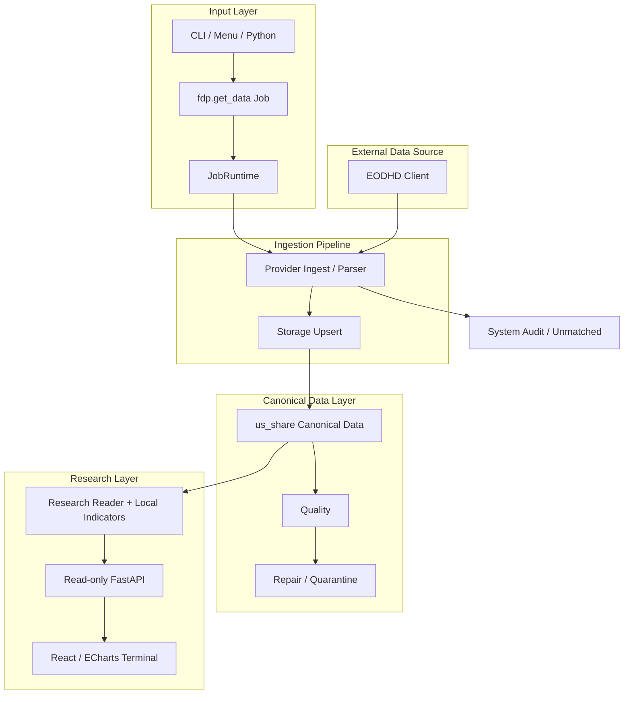
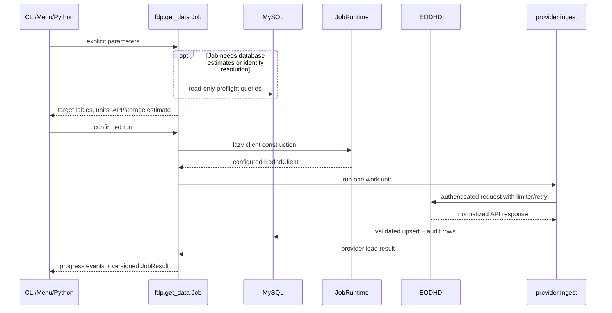
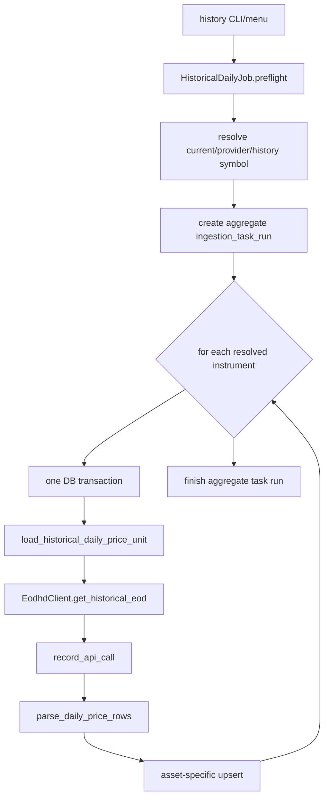
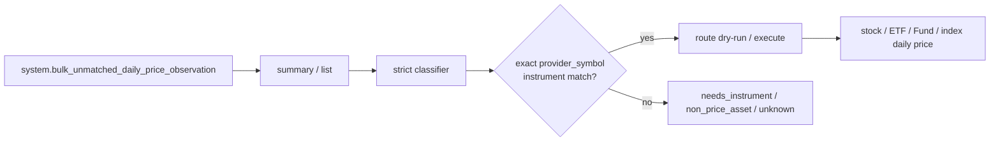
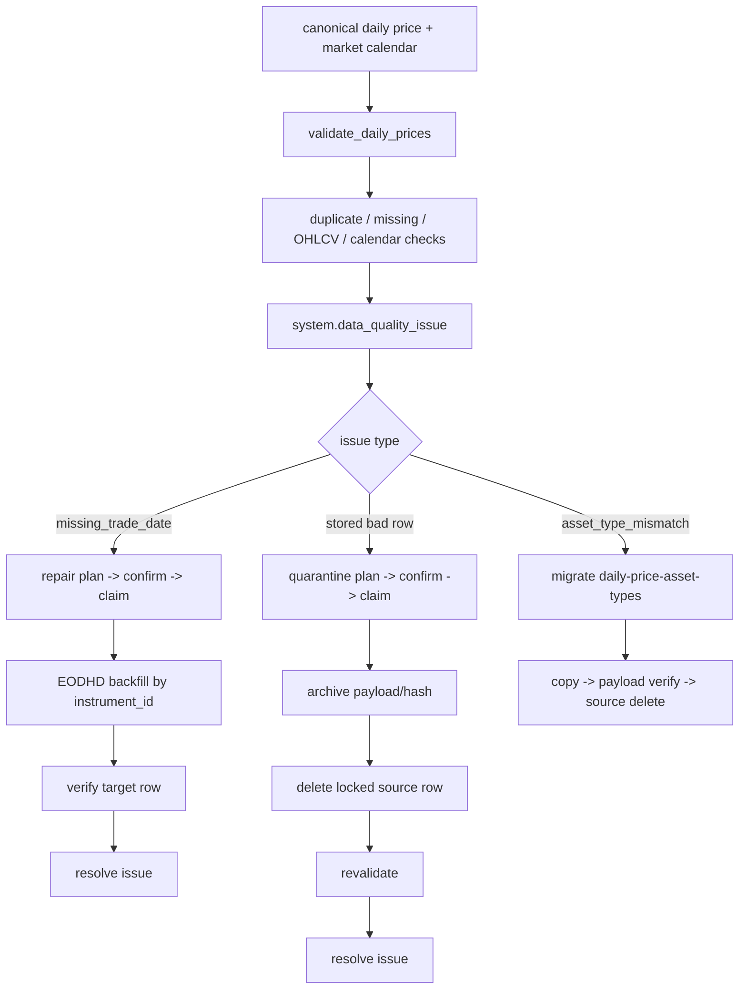

# J21 Database System CLI Architecture

本文是 `database_system_cli` 当前可执行代码的路径地图。它回答三个问题：

1. 用户从哪里进入系统？
2. 数据经过哪些 class/function 才进入数据库？
3. 修改某一层时，必须联查哪些上下游？

文档基于当前代码，而不是未来设想。Markdown 是源文件；同目录
`architecture.html` 是人类阅读版。

## 1. 一句话架构

```text
CLI / terminal menu / Python caller
-> shared fdp.get_data Job
-> EODHD provider client + ingest/parser
-> SQLAlchemy Core upsert + MySQL audit/canonical tables
-> independent quality -> repair/quarantine -> research read/indicator layer
-> sibling read-only FastAPI/React Research Terminal
```

关键边界：CLI 和菜单只是输入/输出 adapter；human-operable ingestion 的参数、预算、
失败策略和结果必须收敛在同一个 `fdp.get_data` Job 中。

## 2. 当前目录职责

| 路径 | 拥有的职责 | 不应放入 |
| --- | --- | --- |
| `src/fdp/cli.py` | Typer command、参数解析、文本/JSON 输出 | provider/SQL 业务流程 |
| `src/fdp/menu/` | 双语 TTY、确认页、等价命令、tqdm | API、预算、写库逻辑 |
| `src/fdp/get_data/` | Job、preflight、runtime、progress、result、registry | 原始 payload parser |
| `src/fdp/sources/eodhd/` | HTTP、retry/rate limit、parser、provider ingest | UI 和 research query |
| `src/fdp/storage/` | SQLAlchemy table contract、schema guard、upsert | migration 历史 |
| `alembic/` | MySQL 物理 schema revision | 运行时业务逻辑 |
| `src/fdp/quality/` | 检测 query、check run、issue persistence | 自动修复/删除 |
| `src/fdp/repair/` | 缺失数据 plan/confirm/claim/backfill | 坏行删除 |
| `src/fdp/quarantine/` | 坏行 plan/confirm/archive/delete/revalidate | missing backfill |
| `src/fdp/research/` | 本地只读查询/指标；受 200-unit cap 的 Technical 口径抽验 | 数据补拉和写库 |
| `src/fdp/bulk_unmatched.py` | unmatched summary/classify/route domain logic | UI 和 API 拉取 |

对应的局部 AI/maintainer 规则位于各路径的 `AGENTS.md`。规则继承顺序是：

```text
repo AGENTS.md -> database_system_cli/AGENTS.md -> nearest scoped AGENTS.md
```

## 3. 总体组件图



注意：`validate`、`repair`、`quarantine` 和 `research` 当前不是 ingest Job。它们由
`fdp/cli.py` 直接调用各自 service/read layer。`j21 menu` 当前只覆盖 registry 中的
ingest/reconcile workflows。

## 4. 三种入口如何汇合

### 4.1 Typer CLI

`pyproject.toml` 同时把 `j21` 和兼容命令 `fdp` 映射到 `fdp.cli:app`。

```text
poetry run j21 ingest daily ...
-> fdp.cli.ingest_daily()
-> BulkDailyJob.run(override_source="cli")
```

CLI 负责把字符串转成 date/list/enum，选择 Job，渲染 `JobResult`。`--output json`
时，stdout 只输出一个 JSON result，progress 走 stderr。

### 4.2 Terminal menu

```text
poetry run j21 menu
-> fdp.cli.terminal_menu()
-> fdp.menu.run_terminal_menu()
-> INGEST_JOB_DEFINITIONS + JOB_HANDLERS
-> Job.preflight()
-> 人工确认（默认取消）
-> Job.run(TqdmProgressReporter)
```

菜单不 shell 调 CLI。它直接调用与 CLI 相同的 Job，因此默认值、预算和失败语义只有
一份。

### 4.3 Python caller

研究脚本或未来 automation 可以直接实例化 Job：

```python
job = StockDailyJob()
preflight = job.preflight(...)
result = job.run(...)
```

参数优先级固定为：

```text
CLI/menu/Python explicit value -> Job module default -> ValueError
```

## 5. Shared Job 内部流程

`fdp.get_data` 的四个基础文件：

- `contracts.py`：`JobPreflight`、`JobResult`、`ProgressEvent`。
- `runtime.py`：创建 SQLAlchemy engine，并延迟创建 EODHD client。
- `registry.py`：菜单可发现 Job 的显式清单。
- `reporting.py`：跨入口的结果/事件格式辅助。



预算拒绝、dry-run 和菜单取消必须发生在 `JobRuntime.client()` 之前，因此这些路径不会
读取 API key，也不会消耗 API call。

## 6. Instrument Master 与生命周期

### 6.1 Active instruments + symbol history

```text
j21 ingest instruments
-> ActiveInstrumentsJob.run()
-> load_exchange_symbols()
-> EodhdClient.get_symbol_change_history()
-> reconcile_symbol_changes()
-> instrument_identifier_history upsert
-> EodhdClient.get_exchange_symbols()
-> parse_exchange_symbol_rows()
-> instrument upsert
-> ingestion_task_run + api_call_log
```

身份规则：`instrument_id` 稳定；`instrument.symbol/provider_symbol` 保存当前值；旧值和
有效期写入 `instrument_identifier_history`。不能仅凭 name/ticker 猜测合并。

### 6.2 Delisted instruments

```text
j21 ingest delisted-instruments
-> DelistedInstrumentsJob.run()
-> load_delisted_instruments()
-> EODHD delisted symbol list
-> parse inactive stock/ETF/Fund rows into canonical asset_type
-> instrument upsert with is_active=false/delisted_date
-> instrument_lifecycle_event upsert by event_key
```

重跑必须幂等：可以刷新 instrument 当前状态，不可重复制造相同 lifecycle event。

## 7. Historical EOD 路径

`j21 ingest history` 根据 `--asset-types` 选择 stock、ETF、Fund、index Job 或通用
`HistoricalDailyJob`。`--instrument-status active|inactive|all` 控制 instrument master
匹配范围；旧 `--include-inactive` 仅为兼容参数。



事务边界不是一个超大 transaction：parent task run 先提交，每个 provider symbol 独立
提交，最后再提交 aggregate counters。单 symbol 失败不会回滚之前已成功的 symbol；
401/402/403、数据库/parser exception 或连续全局 transient failures 会停止后续 work
units。

`IndexDailyJob` 复用 historical base，但先确保 index instrument 存在，再写
`index_daily_price`。`MarketCalendarJob` 调用 exchange details/calendar parser，写入
`market_calendar(calendar_date, is_trading_day, source)`。

EODHD 历史 holiday payload 曾漏掉三个已证实休市日。US calendar parser 因此有显式、
有一手来源的 closure override：Nasdaq 2012 schedule 的 `2012-01-02`，以及 SEC/NYSE
Arca 记录的 Sandy `2012-10-29/30`。这些日期写 source
`NASDAQ_SEC_US_CLOSURE`；不会从“返回行少”自动猜休市。

## 8. Bulk EOD 路径

### 8.1 单日 Bulk

```text
j21 ingest daily
-> BulkDailyJob.run()
-> load_bulk_daily_prices()
-> EodhdClient.get_bulk_eod(exchange, date, optional symbols)
-> load active/all temporal identity map for selected asset types
-> dated identifier history -> current provider symbol -> optional Type compatibility
-> batch natural-key arbitration: unique dated alias wins; lower alias is shadowed
   -> matched: parse_daily_price_rows -> stock/ETF/Fund/index upsert
   -> unmatched: bulk_unmatched_daily_price_observation upsert
-> finish task/API audit -> JobResult
```

单日流程使用一个 transaction。unmatched 不是垃圾，也不会被丢掉；它保留原始 payload、
vendor type、价格字段、首次/最近观察时间和分类状态，等待后续 instrument 补全或人工判断。

### 8.2 多日 Daily Range

```text
j21 ingest daily-range --from ... --to ...
-> DailyRangeJob.preflight()
-> verify complete market_calendar coverage
-> select is_trading_day=true dates
-> estimate API calls and storage
-> User API preflight + thread-safe weighted attempt ledger
-> dry-run by default
-> --execute --yes
-> one load_bulk_daily_prices transaction per trading date
-> optional bounded ThreadPoolExecutor
-> aggregate committed per-day results
```

`--instrument-status active` 适合每日增量；历史 backfill 使用 `all`。每次 HTTP attempt 在发出前
扣除真实 weighted units，retry 同样计费，预算不足时不发送请求。并发只改变“多个交易日同时
进行”，不改变单日事务、upsert 唯一键或 audit 语义。出现 fatal
条件后取消尚未启动的 future，同时收集已经开始的 future，保证结果计数等于真实提交。

## 9. Bulk Unmatched Reconcile



操作顺序：

```text
j21 research bulk-unmatched summary/list
j21 research bulk-unmatched classify
j21 ingest bulk-unmatched-route --dry-run
j21 ingest bulk-unmatched-route --execute --yes
j21 validate daily-price
```

`fdp.bulk_unmatched.classify_bulk_unmatched_observations()` 只接受 exact
source-date/current `provider_symbol` identity match。Fund 路由到 `fund_daily_price`；
preferred/notes/bond/warrant/unknown 不会被猜测写进 canonical price table。route 时重新通过
`parse_daily_price_rows()` 校验价格，并保留 observed symbol/provider symbol。

## 10. 质量、Repair 与 Quarantine



`quality/checks/` 只生成 SELECT；`quality/validation.py` 负责写 check run 和 open issue。
质量检查不自动改市场数据。

instrument metadata 更正可能发生在旧价格写入之后。`asset_type_mismatch` 不走 quarantine；
`j21 migrate daily-price-asset-types --phase plan` 只读列出 source/target/rows，execute 阶段按
chunk transaction copy 到当前 canonical type 表，完整 payload 验证通过后才删除 source。
同 natural key 的目标 payload 不一致时拒绝覆盖并回滚。

Repair 只处理缺失行：执行前重验 issue、instrument/provider symbol 和 plan status，从
`confirmed` 原子 claim 为 `executing`，按 `instrument_id` 回填；目标行存在后才 resolve。

Quarantine 处理已经存在的坏行：必须先归档 payload/hash，再删除锁定源行；归档数与删除数
不一致则失败。只有 exact duplicate payload 能自动 dedupe，冲突 payload 留给人工 review。

## 11. Research Read Layer

```text
j21 research daily-prices
-> DailyPriceReader.get_daily_prices()
-> resolve date range
-> match current symbol / provider_symbol / valid identifier history
-> join instrument to selected split price table
-> expose current lifecycle + historical price symbols
-> return ordered dictionaries
```

Reader 只读本地数据库，不调用 EODHD。`analysis_close` 根据 `adjusted=True/False` 选择
`adjusted_close` 或 raw `close`。`is_active/delisted_date` 来自 instrument join，不复制到
每天的 price row。

```text
local daily rows
-> calculate_daily_indicators(adjusted=True|False)
-> adjusted OHLC + SMA/EMA/Bollinger/RSI/MACD/Volume SMA/volatility
```

`j21 research technical-validate` 是唯一例外的小额 provider 诊断：固定比较
SMA20/EMA20/RSI14，每请求 5 units，总 hard cap 200；它只输出误差报告、不写数据库。
2026-07-11 对 2024 Q1 AAPL/META/SPY 的 9 组真实抽验全部通过，最大 absolute error 小于
`0.00005`；完整记录见 `technical_indicator_parity_report.md`。

## 11.1 Sibling Research Terminal

```text
React/TypeScript/ECharts
-> GET-only FastAPI routes
-> guarded SQLAlchemy Core repository
-> us_share canonical + system audit
-> local indicator transform
```

`../research_terminal/` 提供 Overview、Security Explorer、ETF/Fund、Data Health、safe CSV
和 chart PNG。进程级 SQL guard 拒绝非 SELECT/SHOW/EXPLAIN/WITH，并且部署账号仍应只有
SELECT 权限。没有 ingest/repair/migration HTTP route；页面只复制 CLI。`current_active` 是
当前 master 状态，`price_observed` 不是 point-in-time universe。

## 12. 数据库分层

| Schema | 内容 | 例子 |
| --- | --- | --- |
| `us_share` | canonical instrument/market data | identity/lifecycle/calendar、六种 asset daily price |
| `system` | 运行审计、DQ、人工 workflow、staging | task/API log、issues、repair/quarantine plan、bulk unmatched |
| `app_log` | API playground/search/snapshot 临时响应 | quote/search/screener/live snapshot |

`src/fdp/storage/tables.py` 管理 Data Core 的 runtime table contract；物理变化必须通过
Alembic。`app_log` snapshot 当前由迁移历史管理，不应重新混入 `us_share` canonical
metadata。

ETF/Fund 历史混表已通过 `j21 migrate fund-daily-price` 的 plan/copy/verify/finalize workflow
拆开。Alembic 只建 schema/checkpoint；数千万行 copy/compact swap 在可恢复 Job 中运行，
finalize 需要 verified backup/hash 和 conservation/checksum gate，不自动 `OPTIMIZE TABLE`。

后续 instrument type correction 由通用 `daily-price-asset-types` reconcile 维护跨表不变量；
2026-07-11 已无损搬迁 871 行 `stock -> etf` drift，最终 mismatch count 为 0。

## 13. 常见修改的联查清单

| 修改类型 | 至少联查 |
| --- | --- |
| 新 ingest workflow | Job + registry + CLI + menu + provider ingest + tests/docs |
| EODHD 字段变化 | client/parser + ingest model + storage/upsert + quality/research + tests |
| schema 变化 | tables + Alembic + upsert + callers + tests + PROJECT/HTML |
| 新 quality issue | check + persistence + repair/quarantine/manual route + CLI/tests |
| research 返回字段 | reader query + CLI renderer + tests + PROJECT contract |
| 文档命令变化 | actual Typer `--help` tree + CLI Markdown/HTML + command-registration tests |

## 14. 当前未实现边界

- Terminal menu 尚未覆盖 validate、repair、quarantine 和普通 research 查询。
- High-volume intraday bar store 尚未实现。若未来加入 5-minute 全市场数据，推荐将
  instrument/catalog/quality metadata 留在 SQL，将大规模 bars 放入按资产/周期/日期分区的
  Parquet；不要默认把数亿行 intraday bars 塞入当前日频 MySQL 模型。
- Research Terminal v1 已实现，但不是 PIT universe terminal；等待 universe membership 数据后
  才能增加历史时点成分筛选。

## 15. 验证入口

```bash
cd database_system_cli
poetry run pytest
poetry run ruff check --no-cache src tests scripts
poetry run python -m compileall -q src tests scripts
poetry run alembic heads
poetry run j21 --help
poetry run j21 ingest --help
```

大规模真实 ingest 不属于架构验证；没有用户明确授权时，只运行 dry-run、small smoke 或
只读检查。
