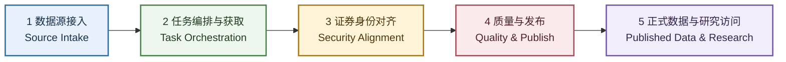
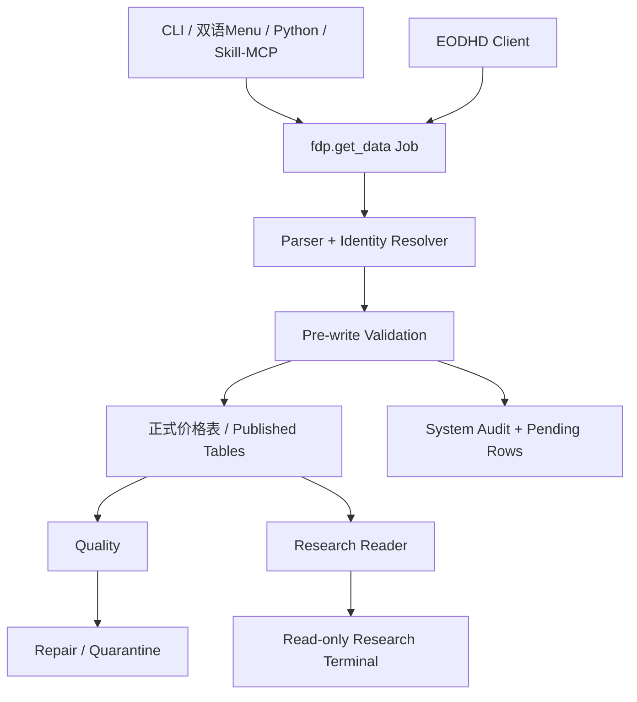
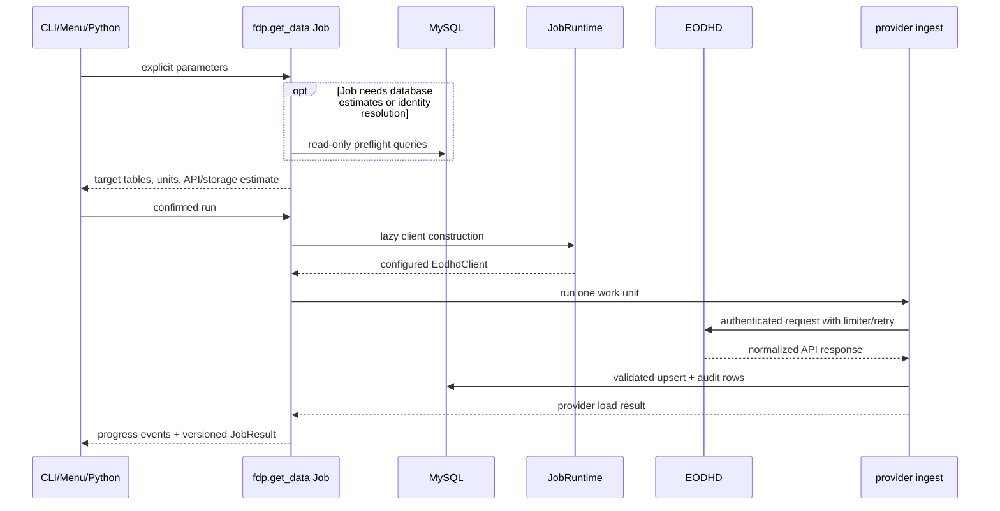
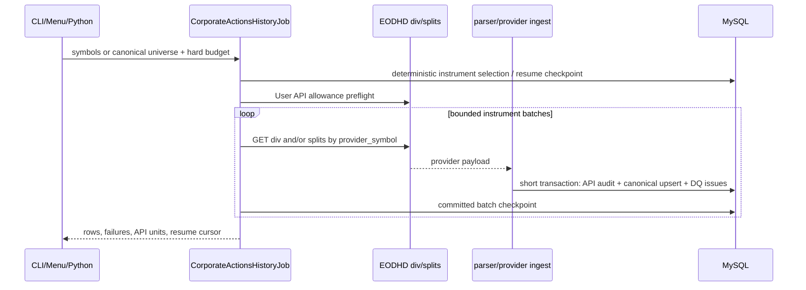
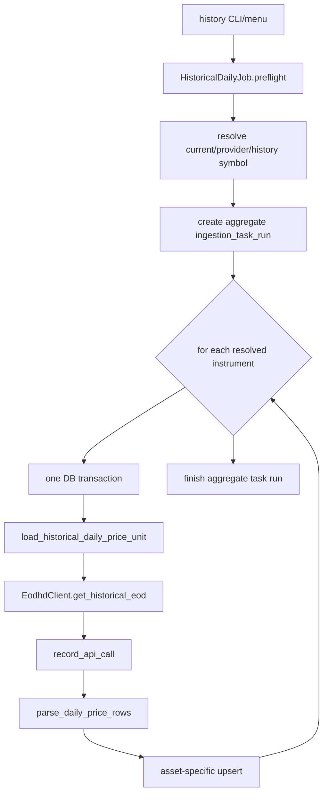
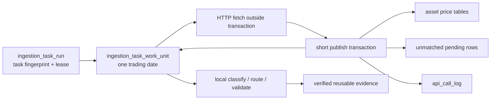
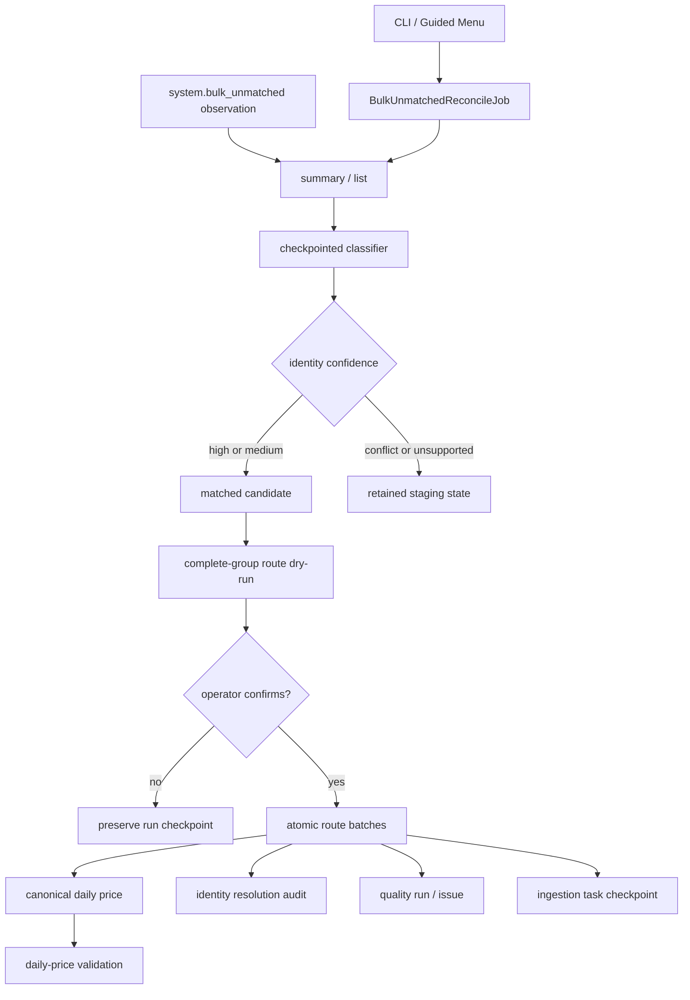
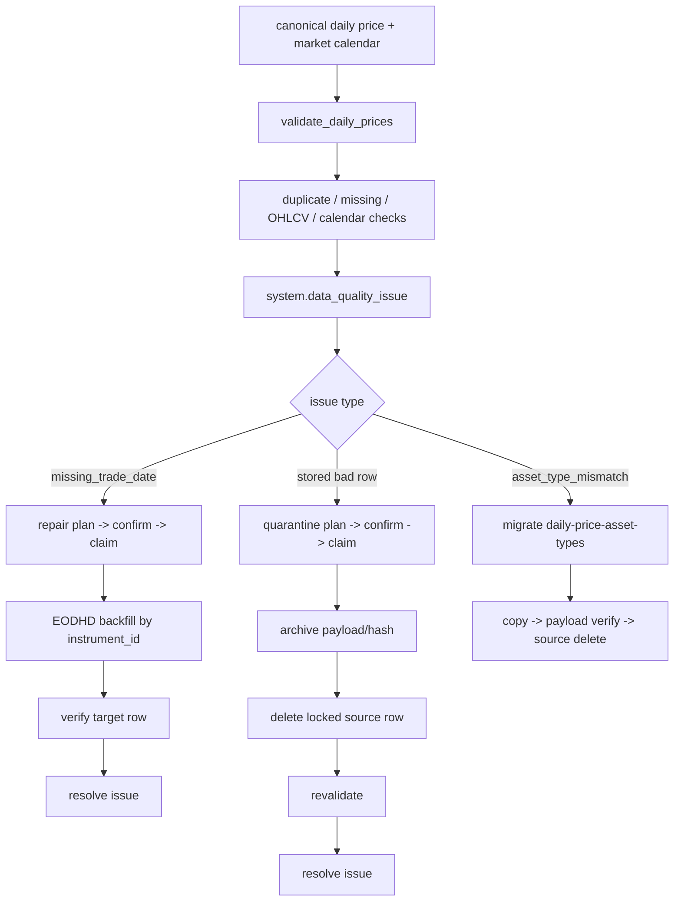
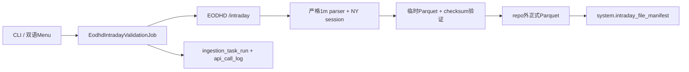

# J21 Database System CLI Architecture

本文先用五个一级板块解释 `database_system_cli`，再追踪当前可执行代码。它回答三个问题：

1. 用户从哪里进入系统？
2. 数据经过哪些 class/function 才进入数据库？
3. 修改某一层时，必须联查哪些上下游？

文档会明确区分 **Current / 当前实现** 与 **Target / 目标结构**，不把计划写成已经完成。
Markdown 是源文件；同目录 `architecture.html` 是带可视化图的人类阅读版。

## 1. 五层架构



| 一级板块 | 二级职责 | 当前主要路径 |
| --- | --- | --- |
| 数据源接入 | API transport、认证、rate limit、retry、provider payload | `src/fdp/sources/eodhd/` |
| 任务编排与获取 | CLI/Menu/Python、preflight、预算、并发、进度、任务状态 | `src/fdp/get_data/`、`src/fdp/cli.py`、`src/fdp/menu/` |
| 证券身份对齐 | instrument、历史 ticker、生命周期、asset type、严格匹配 | `instrument`、`instrument_identifier_history`、identity resolver |
| 质量与发布 | 解析、OHLCV、pending、reconcile、repair、quarantine、短事务 | `quality/`、`repair/`、`quarantine/`、`bulk_unmatched.py` |
| 正式数据与研究访问 | 资产价格表、research reader、只读 Terminal | `us_share`、`research/`、`../research_terminal/` |

关键边界：CLI、Menu、Python、Skill/MCP 都只是入口 adapter；参数、预算、续跑、
失败策略和结果必须收敛在同一个 `fdp.get_data` Job 中。数据源网络请求不能占用长事务；
一个 work unit 的正式数据、待处理行、审计和 checkpoint 才在短事务内一起提交。

人类界面统一使用：`raw / 原始`、`pending / 待处理`、`published / 正式数据`、
`held / 暂缓处理`、`quarantined / 已隔离`。数据库和旧兼容接口中的 `canonical` 名称暂不
大规模重命名，避免把文案简化变成高风险 migration。

## 2. 当前目录职责

| 路径 | 拥有的职责 | 不应放入 |
| --- | --- | --- |
| `src/fdp/cli.py` | Typer command、参数解析、文本/JSON 输出 | provider/SQL 业务流程 |
| `src/fdp/menu/` | 双语 TTY、确认页、等价命令、tqdm | API、预算、写库逻辑 |
| `src/fdp/mcp/` | stdio MCP adapter、只读默认和写入双重授权 | 独立 ingest/SQL 业务流程 |
| `src/fdp/get_data/` | Job、preflight、runtime、progress、result、registry | 原始 payload parser |
| `src/fdp/get_data/corporate_actions/` | dividend/split universe、预算、并发、checkpoint/resume | provider payload mapping |
| `src/fdp/sources/eodhd/` | HTTP、retry/rate limit、parser、provider ingest | UI 和 research query |
| `src/fdp/storage/` | SQLAlchemy table contract、schema guard、upsert | migration 历史 |
| `alembic/` | MySQL 物理 schema revision | 运行时业务逻辑 |
| `src/fdp/quality/` | 检测 query、check run、issue persistence | 自动修复/删除 |
| `src/fdp/repair/` | 缺失数据 plan/confirm/claim/backfill | 坏行删除 |
| `src/fdp/quarantine/` | 坏行 plan/confirm/archive/delete/revalidate | missing backfill |
| `src/fdp/research/` | 本地只读查询/指标；受 200-unit cap 的 Technical 口径抽验 | 数据补拉和写库 |
| `src/fdp/bulk_unmatched.py` | unmatched summary/classify/route domain logic | UI 和 API 拉取 |

对应的局部 AI/maintainer 规则位于各路径的 `AGENTS.md`。规则继承顺序是：

```text
repo AGENTS.md -> database_system_cli/AGENTS.md -> nearest scoped AGENTS.md
```

## 3. 当前组件流



注意：大部分 `validate`、`repair`、`quarantine` 和 `research` 仍由 `fdp/cli.py` 直接调用
各自 service/read layer。1m validation 是明确例外：CLI 和双语 Menu 都调用
`EodhdIntradayValidationJob`，因此 provider、Parquet 和 manifest 逻辑没有第二份实现。

Daily 自动续跑、`--new-run`、默认自动处理、Skill 和 MCP 已由
`08-10-resumable-bulk-daily-workflow` 交付。1m validation 使用独立的 raw Parquet contract
和 MySQL manifest；Massive 和 PIT 不在本轮范围。

## 4. 四种入口如何汇合

### 4.1 Typer CLI

`pyproject.toml` 同时把 `j21` 和兼容命令 `fdp` 映射到 `fdp.cli:app`。

```text
poetry run j21 ingest daily ...
-> fdp.cli.ingest_daily()
-> BulkDailyJob.run(override_source="cli")
```

CLI 负责把字符串转成 date/list/enum，选择 Job，渲染 `JobResult`。`--output json`
时，stdout 只输出一个 JSON result，progress 走 stderr。

### 4.2 Terminal menu

```text
poetry run j21 menu
-> fdp.cli.terminal_menu()
-> fdp.menu.run_terminal_menu()
-> INGEST_JOB_DEFINITIONS + JOB_HANDLERS
-> Job.preflight()
-> 人工确认（默认取消）
-> Job.run(TqdmProgressReporter)
```

菜单不 shell 调 CLI。它直接调用与 CLI 相同的 Job，因此默认值、预算和失败语义只有
一份。

### 4.3 Python caller

研究脚本或未来 automation 可以直接实例化 Job：

```python
job = StockDailyJob()
preflight = job.preflight(...)
result = job.run(...)
```

参数优先级固定为：

```text
CLI/menu/Python explicit value -> Job module default -> ValueError
```

### 4.4 Skill 与 MCP

`.agents/skills/j21-daily-ingest/` 是操作说明，不复制业务代码。`j21-mcp` 以 stdio 启动
`fdp.mcp.server`，并把 `daily_preflight`、`daily_range_preflight`、`task_list`、
`task_status`、`daily_execute` 和 `daily_range_execute` 映射回相同的 Job/TaskLedger。

MCP 默认只读。执行工具必须同时满足服务端 `J21_MCP_ENABLE_WRITES=1` 和单次调用
`confirm_execute=true`；它仍受 Daily task fingerprint、live lease、`max_api_calls`、
自动续跑和质量流程约束。stdio stdout 只用于 MCP protocol，不能混入日志或进度文本。

## 5. Shared Job 内部流程

`fdp.get_data` 的四个基础文件：

- `contracts.py`：`JobPreflight`、`JobResult`、`ProgressEvent`。
- `runtime.py`：创建 SQLAlchemy engine，并延迟创建 EODHD client。
- `registry.py`：菜单可发现 Job 的显式清单。
- `reporting.py`：跨入口的结果/事件格式辅助。



预算拒绝、dry-run 和菜单取消必须发生在 `JobRuntime.client()` 之前，因此这些路径不会
读取 API key，也不会消耗 API call。

## 6. Instrument Master 与生命周期

### 6.1 Active instruments + symbol history

```text
j21 ingest instruments
-> ActiveInstrumentsJob.run()
-> load_exchange_symbols()
-> EodhdClient.get_symbol_change_history()
-> reconcile_symbol_changes()
-> instrument_identifier_history upsert
-> EodhdClient.get_exchange_symbols()
-> parse_exchange_symbol_rows()
-> instrument upsert
-> ingestion_task_run + api_call_log
```

身份规则：`instrument_id` 稳定；`instrument.symbol/provider_symbol` 保存当前值；旧值和
有效期写入 `instrument_identifier_history`。不能仅凭 name/ticker 猜测合并。

### 6.2 Delisted instruments

```text
j21 ingest delisted-instruments
-> DelistedInstrumentsJob.run()
-> load_delisted_instruments()
-> EODHD delisted symbol list
-> parse inactive stock/ETF/Fund rows into canonical asset_type
-> instrument upsert with is_active=false/delisted_date
-> instrument_lifecycle_event upsert by event_key
```

重跑必须幂等：可以刷新 instrument 当前状态，不可重复制造相同 lifecycle event。

### 6.3 Security ID Mapping

```text
j21 ingest id-mappings --exchange US|--symbols AAPL.US,...
-> IdentifierMappingJob.preflight()
-> audited EODHD User API allowance check
-> EodhdClient.get_id_mappings()
-> parse/check CUSIP, ISIN, FIGI, LEI, CIK
-> exact current provider_symbol
-> unique historical provider_symbol owner
   -> matched/valid: instrument_identifier_history upsert
   -> unresolved/ambiguous/invalid: system identifier_mapping_unmatched_observation
-> ingestion_task_run + api_call_log + optional next_offset
```

CLI、菜单和 Python caller 共用同一个 `IdentifierMappingJob`。exchange mode 使用最多
1000 rows/page 的 offset pagination；targeted symbols 只用于 smoke/repair。每个 mapping HTTP
attempt 在发出前扣 1 个 weighted unit，retry 同样扣费；另有一次 audited User API preflight。
预算停止后返回可续跑 offset。分页完整但仍有 reconciliation backlog 时，状态可以是
`partial_failed`，但 `next_offset` 为 `NULL`。

该 API 不返回 identifier 生效日期，所以 `valid_from/valid_to` 保持 `NULL`，不能宣称
current-only 或 PIT。同一 instrument/type 的多个 validated values 作为 undated aliases 全部保留；
不能按 provider 返回顺序任取第一值。
MySQL 通过 generated `valid_from_key` 只在唯一约束内部把 `NULL` 归一化，业务字段本身不伪造日期。
外部 ID 只 enrich 已通过 provider symbol 严格定位的 `instrument_id`，不能反向触发 fuzzy merge。

### 6.4 Dividend And Split History



`src/fdp/get_data/corporate_actions/get_history.py` owns universe selection、whole-task weighted
budget、bounded parallel fetch、fatal stop、checkpoint 和 resume。HTTP calls occur outside database
transactions。`src/fdp/sources/eodhd/corporate_actions.py` 显式映射 dividend/split payload；
无效的零/负现金值、无效 ratio 和同日冲突写入 quality issue，不做 silent coercion。
`src/fdp/sources/eodhd/ingest/corporate_actions.py` 在短事务内一起提交 API evidence、canonical
rows 和 DQ issue，并串行化这些短写事务以避免并发 deadlock。

该 Job 的 universe 固定为 `instrument.asset_type='stock'`，CLI/Menu 没有 ETF/Fund selector。
每个历史事件先经过 `CorporateActionIdentityResolver`：事件日有效的 provider-symbol history
优先；没有 dated prior owner 时，唯一 current endpoint owner 可以保留 pre-rename history；
dated non-stock owner 会被拒绝，重叠历史 owner 会进入 DQ。旧混合范围数据通过
`j21 migrate corporate-action-identities` 在备份后先迁移 dated stock rows，再删除所有剩余
non-stock corporate-action rows；该命令不改 ETF/Fund instrument 或 price tables。

2026-07-18 的真实收口与回填最终得到 867,857 条 stock corporate-action rows；非股票行、
natural-key duplicates 和 invalid typed rows 均为 0。任务 run `7030..7038` 合计使用
99,800 API units；最终 inactive-stock run `7038` 完成 23,846 个 instrument。解析器仍会
读取非股票 ticker owner 作为冲突排除证据，但 API 请求范围和 canonical 写入范围始终只含
stock。

初次历史回填使用 one-unit-per-symbol `/div/{ticker}` 和 `/splits/{ticker}`。Full-exchange
date Bulk 每 action type/date 计 100 units，留给后续 daily incremental workflow。Menu 和 Typer
调用同一 Job；默认 dry-run，真实请求和写库必须显式确认。

## 7. Historical EOD 路径

`j21 ingest history` 根据 `--asset-types` 选择 stock、ETF、Fund、index Job 或通用
`HistoricalDailyJob`。`--instrument-status active|inactive|all` 控制 instrument master
匹配范围；旧 `--include-inactive` 仅为兼容参数。



事务边界不是一个超大 transaction：parent task run 先提交，每个 provider symbol 独立
提交，最后再提交 aggregate counters。单 symbol 失败不会回滚之前已成功的 symbol；
401/402/403、数据库/parser exception 或连续全局 transient failures 会停止后续 work
units。

`IndexDailyJob` 复用 historical base，但先确保 index instrument 存在，再写
`index_daily_price`。`MarketCalendarJob` 调用 exchange details/calendar parser，写入
`market_calendar(calendar_date, is_trading_day, source)`。

EODHD 历史 holiday payload 曾漏掉三个已证实休市日。US calendar parser 因此有显式、
有一手来源的 closure override：Nasdaq 2012 schedule 的 `2012-01-02`，以及 SEC/NYSE
Arca 记录的 Sandy `2012-10-29/30`。这些日期写 source
`NASDAQ_SEC_US_CLOSURE`；不会从“返回行少”自动猜休市。

## 8. Bulk EOD 路径

### 8.1 单日 Bulk

```text
j21 ingest daily
-> BulkDailyJob.run()
-> resolve explicit/latest ready New York trading date
-> delegate the one-date scope to DailyRangeJob
-> use the same task ledger, fetch/publish, reconcile, and validation contract
```

Stock/ETF 的 latest readiness 是纽约时间交易日 16:30；选择 Fund 时等待到下一日 06:30。
单日和多日不再维护两套写库逻辑。unmatched 不是垃圾，也不会被丢掉；它保留原始 payload、
vendor type、价格字段、首次/最近观察时间和分类状态，等待自动或人工后处理。

### 8.2 多日 Daily Range

```text
j21 ingest daily-range --from ... --to ...
-> DailyRangeJob.preflight()
-> plan calendar/instrument prerequisites
-> build immutable task fingerprint and per-date fingerprints
-> estimate only unfinished provider work
-> dry-run by default; --execute --yes enters execution
-> exact completed task: return prior result with 0 provider calls
-> exact incomplete task: acquire stale/available lease and resume
-> overlapping task: reuse only verified dates
-> optional --new-run: create fresh task, unless live equivalent lease exists
-> refresh prerequisites + audited User API budget check
-> for each remaining date:
   claim work unit
   fetch outside DB transaction
   compare recent verified baseline; retry once when response is materially thin
   short transaction: published rows + pending rows + API audit + checkpoint
-> unless --manual: local classify -> route -> daily-price validate
-> mark verified dates and finalize task
```

`--instrument-status active` 适合每日增量；历史 backfill 使用 `all`。每次 HTTP attempt 在发出前
扣除真实 weighted units，retry 同样计费，预算不足时不发送请求。并发只改变“多个交易日同时
进行”，不改变短事务、upsert 唯一键或 audit 语义。长时间 provider/reconcile 阶段由后台
heartbeat 续租；同 scope 的 live lease 会拒绝第二个进程。出现 fatal 条件后取消尚未启动的
future，同时收集已经开始的 future，保证结果计数等于真实提交。

任务身份固定包含 source、market、exchange、日期范围、排序后的 asset types、local
instrument status、symbol filter 和 data-contract version。workers、语言、输出格式、限速和
本次预算不是身份字段。`held` 表示响应偏薄或需要复核：有效数据可发布，但该日期不成为可
复用完成证据，后续同 scope 会再次尝试。逐日要求 source-row 闭合：
`fetched = published + pending + rejected`；不闭合时该 work unit 保持失败/可续跑。



## 9. Bulk Unmatched Reconcile



操作顺序：

```text
j21 reconcile bulk-unmatched summary/list
j21 reconcile bulk-unmatched classify
j21 reconcile bulk-unmatched status --run-id ...
j21 reconcile bulk-unmatched route --dry-run --run-id ...
j21 reconcile bulk-unmatched route --execute --yes --run-id ...
j21 validate daily-price
```

`src/fdp/get_data/reconcile/bulk_unmatched.py` 是统一 Job adapter；CLI 和 Menu 都调用
`BulkUnmatchedReconcileJob`。`src/fdp/get_data/reconcile/workflow.py` 负责创建、解析和保存
`checkpoint_json`；`src/fdp/bulk_unmatched.py` 负责 SELECT、身份决策和完整 natural-key group
路由；`src/fdp/menu/reconcile_ui.py` 只负责 Rich 展示，不拥有业务规则。

Classifier 默认每批 5,000 rows，用 `(trade_date, observation_id)` keyset cursor 读取固定
snapshot。MySQL 查询使用 `(market, classification_status, trade_date, observation_id)` 复合
索引。CLI 默认只处理 `unresolved`；Menu 默认处理
`unresolved + needs_instrument + unknown`。`ambiguous` 和 `non_price_asset` 必须显式使用高级
选项。整个 reconcile 路径不会构造 EODHD client，任务和 API log 验证值均为 0。

身份规则：有效日期内唯一 identifier history 是 high-confidence；没有历史冲突的唯一 current
provider symbol 是 medium-confidence；无日期 CUSIP/ISIN/FIGI 只能辅助审计。多个 owner、历史
冲突或 EODHD type 不兼容都留在 staging，不猜测合并。

Router 每批最多处理 1,000 个完整 `(instrument_id, trade_date)` 组合。dated-history winner
优先，其余 alias 标为 `shadowed`。相同 provider symbol 可以刷新 EODHD row；不同 symbol 只有
新的 high-confidence 判定可以替换已明确记录为 medium-confidence 的 canonical identity。
同级、降级或旧 confidence 不明时禁止覆盖，保留原 row，并写
`identity_route_conflict` quality issue。route 时仍通过 `parse_daily_price_rows()` 校验 OHLCV，
并保留 source 当日 symbol/provider symbol。

一个 batch 内的 staging 更新、canonical upsert、identity audit、quality issue 和 checkpoint
共用一个 transaction。失败只回滚当前 batch，先前提交保留。`Ctrl+C` 后用同一 `run_id`
继续；scope 不一致会拒绝 resume。旧 `research bulk-unmatched` 和
`ingest bulk-unmatched-route` 在 v0.4 只是带 warning 的兼容代理，v0.5 删除。
每批及最终 validation 同时检查
`observations_selected = routed + shadowed + route_failed` 和 `canonical writes = routed`；
不闭合时不得报告 success。价格 payload 校验失败写 `invalid_ohlcv` 或 `api_rejected_row`，
不能误记为 identity conflict。

## 10. 质量、Repair 与 Quarantine



`quality/checks/` 只生成 SELECT；`quality/validation.py` 负责写 check run 和 open issue。
质量检查不自动改市场数据。

instrument metadata 更正可能发生在旧价格写入之后。`asset_type_mismatch` 不走 quarantine；
`j21 migrate daily-price-asset-types --phase plan` 只读列出 source/target/rows，execute 阶段按
chunk transaction copy 到当前 canonical type 表，完整 payload 验证通过后才删除 source。
同 natural key 的目标 payload 不一致时拒绝覆盖并回滚。

Repair 只处理缺失行：执行前重验 issue、instrument/provider symbol 和 plan status，从
`confirmed` 原子 claim 为 `executing`，按 `instrument_id` 回填；目标行存在后才 resolve。

Quarantine 处理已经存在的坏行：必须先归档 payload/hash，再删除锁定源行；归档数与删除数
不一致则失败。只有 exact duplicate payload 能自动 dedupe，冲突 payload 留给人工 review。

## 11. Research Read Layer

```text
j21 research daily-prices
-> DailyPriceReader.get_daily_prices()
-> resolve date range
-> match current symbol / provider_symbol / valid identifier history
-> join instrument to selected split price table
-> expose current lifecycle + historical price symbols
-> return ordered dictionaries
```

Reader 只读本地数据库，不调用 EODHD。`analysis_close` 根据 `adjusted=True/False` 选择
`adjusted_close` 或 raw `close`。`is_active/delisted_date` 来自 instrument join，不复制到
每天的 price row。

```text
local daily rows
-> calculate_daily_indicators(adjusted=True|False)
-> adjusted OHLC + SMA/EMA/Bollinger/RSI/MACD/Volume SMA/volatility
```

`j21 research technical-validate` 是唯一例外的小额 provider 诊断：固定比较
SMA20/EMA20/RSI14，每请求 5 units，总 hard cap 200；它只输出误差报告、不写数据库。
2026-07-11 对 2024 Q1 AAPL/META/SPY 的 9 组真实抽验全部通过，最大 absolute error 小于
`0.00005`；完整记录见 `technical_indicator_parity_report.md`。

## 11.1 Sibling Research Terminal

```text
React/TypeScript/ECharts
-> GET-only FastAPI routes
-> guarded SQLAlchemy Core repository
-> us_share canonical + system audit
-> local indicator transform
```

`../research_terminal/` 是本地可选集成，不随公开源码分发，也不是 CLI 安装、测试或文档
检查的依赖。它提供 Overview、Security Explorer、ETF/Fund、Data Health、safe CSV
和 chart PNG。进程级 SQL guard 拒绝非 SELECT/SHOW/EXPLAIN/WITH，并且部署账号仍应只有
SELECT 权限。没有 ingest/repair/migration HTTP route；页面只复制 CLI。`current_active` 是
当前 master 状态，`price_observed` 不是 point-in-time universe。

## 12. 数据库分层

| Schema | 内容 | 例子 |
| --- | --- | --- |
| `us_share` | canonical instrument/market data | identity/lifecycle/corporate actions/calendar、六种 asset daily price |
| `system` | 运行审计、DQ、人工 workflow、staging | task/API log、issues、repair/quarantine plan、bulk/ID-mapping unmatched |
| `app_log` | API playground/search/snapshot 临时响应 | quote/search/screener/live snapshot |

`src/fdp/storage/tables.py` 管理 Data Core 的 runtime table contract；物理变化必须通过
Alembic。`app_log` snapshot 当前由迁移历史管理，不应重新混入 `us_share` canonical
metadata。`system` 每张表的用途、写入者、读取者、保留策略和删除边界见
[`system_tables.md`](system_tables.md)。

ETF/Fund 历史混表已通过 `j21 migrate fund-daily-price` 的 plan/copy/verify/finalize workflow
拆开。Alembic 只建 schema/checkpoint；数千万行 copy/compact swap 在可恢复 Job 中运行，
finalize 需要 verified backup/hash 和 conservation/checksum gate，不自动 `OPTIMIZE TABLE`。

后续 instrument type correction 由通用 `daily-price-asset-types` reconcile 维护跨表不变量；
2026-07-11 已无损搬迁 871 行 `stock -> etf` drift，最终 mismatch count 为 0。

## 13. 常见修改的联查清单

| 修改类型 | 至少联查 |
| --- | --- |
| 新 ingest workflow | Job + registry + CLI + menu + provider ingest + tests/docs |
| EODHD 字段变化 | client/parser + ingest model + storage/upsert + quality/research + tests |
| schema 变化 | tables + Alembic + upsert + callers + tests + PROJECT/HTML |
| 新 quality issue | check + persistence + repair/quarantine/manual route + CLI/tests |
| research 返回字段 | reader query + CLI renderer + tests + PROJECT contract |
| 文档命令变化 | actual Typer `--help` tree + CLI Markdown/HTML + command-registration tests |

## 14. Intraday 1m validation path



路径固定为
`validation/source=eodhd/asset_type=stock/interval=1m/trade_date=YYYY-MM-DD/bucket=NN/part-<content-hash>.parquet`。
一个文件只含一个 instrument/trade_date；自然键为
`(source, instrument_id, timestamp_utc, interval)`。时间戳存 UTC，交易日和
pre/core/after 用 New York 时区。MySQL 只保存 manifest，不保存 bars。

`J21_INTRADAY_DATA_ROOT` 必须是 repo 外绝对路径。缺失、相对路径、repo 内路径、根目录、
home 或 symlink 在创建 client/文件前失败。provider 请求最多覆盖 120 天，每次按 5 units，
公开验证命令含 `/user` 和 retries 的总 hard cap 为 200。测试只用 fixture/mock，真实调用为 0。

## 15. 当前未实现边界

- Terminal menu 只新增 1m validation；其他 validate、repair、quarantine 和普通 research 查询尚未覆盖。
- High-volume intraday production backfill 尚未实现。当前只实现 EODHD stock 1m 小样本契约验证；
  5/15/30m 将来按 session 从 1m 本地聚合，不重复保存 raw provider datasets。
- Research Terminal v1 已实现，但不是 PIT universe terminal；等待 universe membership 数据后
  才能增加历史时点成分筛选。

## 16. 验证入口

```bash
cd database_system_cli
poetry run pytest
poetry run ruff check --no-cache src tests scripts
poetry run python -m compileall -q src tests scripts
poetry run alembic heads
poetry run j21 --help
poetry run j21 ingest --help
poetry run j21 ingest corporate-actions --help
```

大规模真实 ingest 不属于架构验证；没有用户明确授权时，只运行 dry-run、small smoke 或
只读检查。
