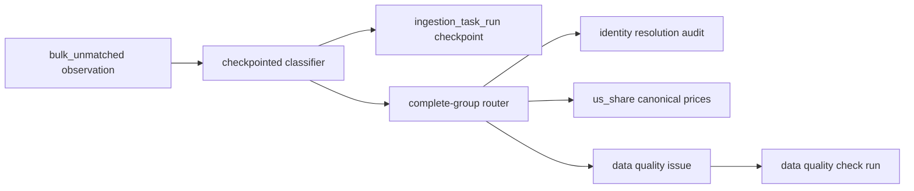

# J21 System Schema Table Guide

`system` schema 保存运行审计、数据质量、人工修复和 reconciliation 状态。它不保存
canonical market data；正式 instrument 和价格仍位于 `us_share`。本页描述当前代码实际
管理的表，不代表可以绕过 CLI 直接修改。

## 保留原则

- 当前版本不自动清理、归档或压缩任何 `system` 表。
- `run_id`、`check_run_id`、plan ID 和 observation ID 是审计链的一部分，不能按单表随意删除。
- `resolved`、`routed`、`shadowed` 和 `superseded` 表示状态已变化，不表示记录可以删除。
- 若未来需要归档，必须先定义跨表引用、恢复方式和可复算范围，并单独实现迁移任务。

## 表级职责

| 表 | 用途 | 主要写入者 | 主要读取者 | 当前保留策略 | 可直接删除？ |
| --- | --- | --- | --- | --- | --- |
| `ingestion_task_run` | 记录 ingest、migration 和 reconcile 的运行状态、计数、错误及 `checkpoint_json` | `fdp.get_data` Jobs、ingest/migration/reconcile services | CLI status、Menu、审计查询 | 长期保留；checkpoint 是中断续跑依据 | 否；多张表通过 run ID 引用 |
| `api_call_log` | 记录供应商请求摘要、状态码、重试和耗时，不保存完整响应 | EODHD client/ingest runtime | 预算核对、故障排查 | 当前长期保留；未来可按完整 run 归档 | 否；不得孤立删除部分请求 |
| `instrument_identity_resolution_audit` | 汇总 Bulk ticker 到 instrument 的身份判定、置信度和证据区间 | Bulk direct ingest、reconcile route | route 冲突保护、后续 Fundamental 复核、审计 | 永久保留；新结论用 `supersedes_audit_id` 取代旧结论 | 否 |
| `bulk_unmatched_daily_price_observation` | 保存 Bulk EOD 未直接匹配的原始观测及分类/路由状态 | Bulk ingest、classifier、router | reconcile CLI/Menu、研究诊断 | 全量保留；本版本没有自动清理 | 否；`routed/resolved/shadowed` 仍是证据 |
| `identifier_mapping_unmatched_observation` | 保存无法安全写入 identifier history 的 ID Mapping 行 | ID Mapping ingest/reconcile | 人工复核、后续 instrument 补全 | 全量保留，重复观察按 fingerprint 更新 | 否 |
| `data_quality_check_run` | 记录每次质量检查范围、状态和 issue 数 | validate、reconcile route conflict check | CLI/Menu、质量面板 | 长期保留 | 否；与 issue 构成审计链 |
| `data_quality_issue` | 保存重复键、OHLCV、交易日、身份路由冲突等具体问题 | quality validators、reconcile router | repair/quarantine、人工 review、Terminal | open/resolved 均保留 | 否 |
| `repair_plan` | 保存需人工确认的缺失价格修复计划 | repair CLI/service | repair CLI、审计查询 | 执行前后均保留 | 否 |
| `quarantine_plan` | 保存需人工确认的坏行隔离或去重计划 | quarantine/dedupe CLI/service | quarantine CLI、审计查询 | 执行前后均保留 | 否 |
| `quarantined_daily_price_row` | 在删除 canonical 坏行前保存原 payload 和 hash | quarantine executor | 恢复、审计、post-action verification | 永久保留，除非另有合规归档方案 | 否 |
| `fund_daily_price_split_run` | 保存 ETF/Fund 大表拆分的 backup、checkpoint 和验收证据 | fund split migration Job | migration status、审计 | 迁移完成后仍长期保留 | 否 |

## Guided Reconcile 关系



`classify` 和 `route` 不调用 EODHD。每个已提交批次的数据修改与 checkpoint 使用同一
transaction；失败批次整体回滚，先前批次保留。身份冲突继续留在 staging，并写入现有质量
表，不自动移动或覆盖 canonical 数据。

## 运维查询

只读查看运行状态：

```bash
poetry run j21 reconcile bulk-unmatched status --run-id <RUN_ID>
```

查看某一日期范围的 staging 组成：

```bash
poetry run j21 reconcile bulk-unmatched summary \
  --from <FROM> --to <TO>
```

需要清理或归档时，不应直接执行 `DELETE`。先创建独立任务，评估外键、恢复需求、历史研究
可复算性和磁盘回收成本。
