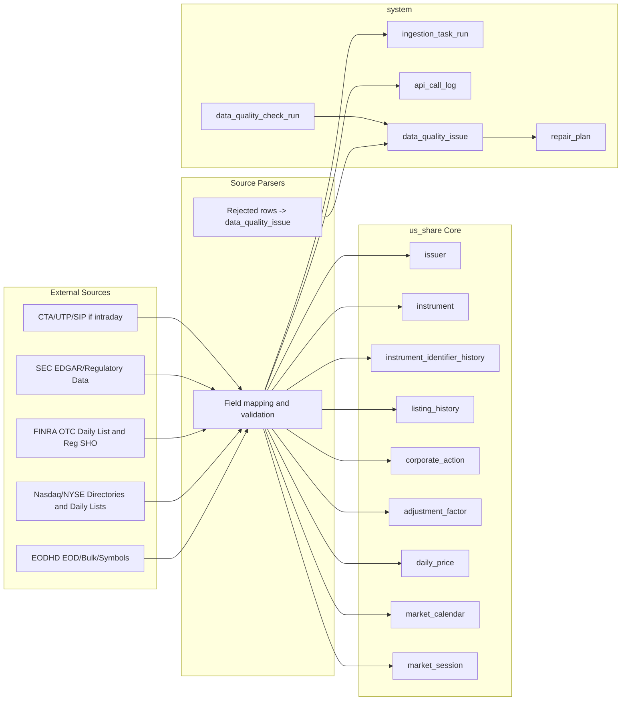
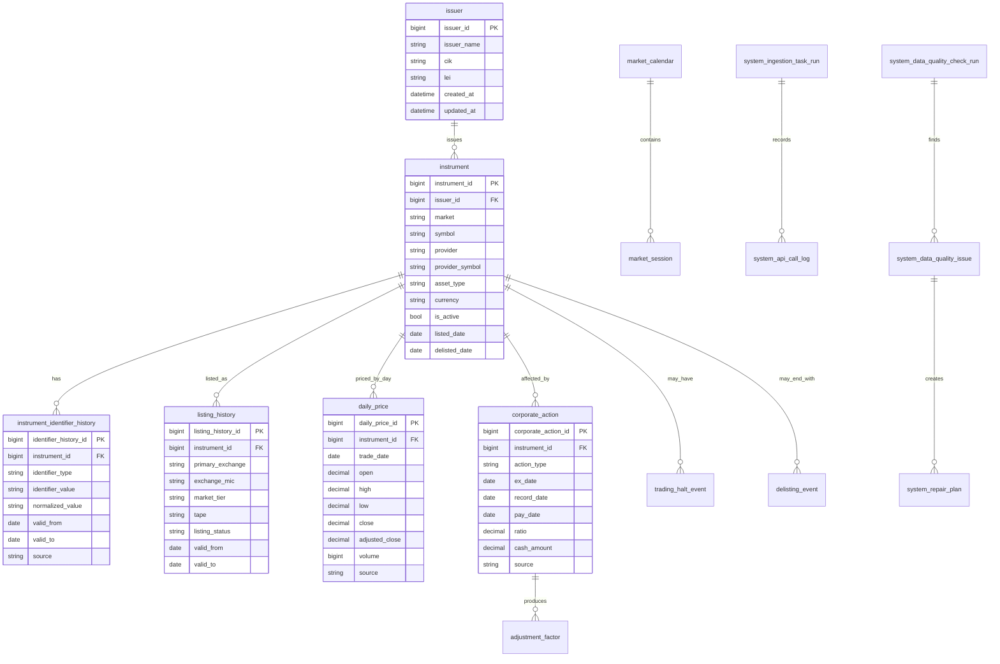

# 美股市场规则与数据库架构研究报告

日期：2026-05-28  
范围：本报告面向 `financial-data-platform` 第一阶段及后续美股 schema 设计。当前阶段仍以 EODHD、US active stock/ETF、MySQL、`us_share` 和 `system` schema 为边界；本报告不修改现有代码和 migration。

## 摘要

美股数据库的核心设计结论是：不能把 ticker 当成永久主键。美股的 ticker 会变，会随交易所迁移保留，也可能在释放后被重新使用；同一家公司可以有多个证券，例如 A/B 类股、优先股、ADR、ETF、SPAC unit/warrant；一次 merger、spin-off、reverse split、delisting 或 relisting 可能改变 CUSIP、symbol、listing exchange、market tier，但不一定改变研究意义上的 security lineage。

CRSP 的公开说明给出最重要的架构启发：用永久 security id 和 company id 穿透 corporate actions。CRSP 的 `PERMNO` 是 security 层级的永久编号，`PERMCO` 是 company 层级的永久编号；CRSP 覆盖 active 和 inactive securities，并把 corporate actions、delisting information、identifiers、returns、volume 等作为长期研究数据的一部分。这个思路比“用当前 symbol 查价格”更适合量化回测。

对本项目而言，当前 `us_share.instrument.instrument_id` 可以继续作为内部 security id 的雏形，但后续应明确补充：

- `issuer`：公司/发行人层级，近似 CRSP `PERMCO` 或 SEC CIK 层。
- `instrument_identifier_history`：ticker、provider_symbol、CUSIP、ISIN、FIGI、CIK 等随时间变化的历史。
- `listing_history`：primary listing exchange、Nasdaq market tier、tape/network、active/delisted 状态历史。
- `corporate_action` 与 `adjustment_factor`：拆股、分红、换名、换码、合并、分拆、退市、重上市等事件。
- `delisting_event` 或统一的 `security_lifecycle_event`：解决 survivorship bias，避免只保存当前 active symbol。
- `market_session`：在现有 `market_calendar` 之外保存 pre-market、core、late/after-hours、early close 等 session 语义。

## 1. 项目现状

从 `PROJECT.md`、`PROGRESS.md`、`README.md` 和 `主人的流程.md` 可以归纳当前架构：

| 层 | 当前设计 |
| --- | --- |
| 数据源 | EODHD paid API；第一阶段只做 US active stock/ETF |
| 数据范围 | 近 20 年日频 OHLCV；当前不含退市标的 |
| 数据库 | 本机 MySQL；schema 为 `us_share`、`a_share`、`system` |
| 工程栈 | Python、Poetry、SQLAlchemy Core、Alembic、Typer、pytest、YAML、`.env` |
| 主表 | `us_share.instrument`、`us_share.daily_price`、`us_share.market_calendar` |
| 系统表 | `system.ingestion_task_run`、`system.api_call_log`、`system.data_quality_check_run`、`system.data_quality_issue`、`system.repair_plan` |
| 写入原则 | 大批量写入必须唯一键 upsert；异常 OHLCV 不入库；缺失交易日不插空行 |
| 已完成 | scaffold、初始 schema/migration、EODHD instrument parser、instrument ingestion、upsert builder、单元测试 |
| 未开始 | historical daily price ingestion、quality checks、repair workflow、database-backed access functions |

本报告的假设：

1. 第一阶段不扩 schema，只为后续美股专用 schema 设计做研究准备。
2. 后续需要同时支持 active 和 delisted securities，否则回测会有 survivorship bias。
3. EODHD 的 `provider_symbol` 必须保留，例如 `AAPL.US`；标准 `symbol` 也必须保留，例如 `AAPL`。
4. 报告中的“规则”只覆盖数据库设计需要的美股股票/ETF/ETP 规则，不覆盖期权、期货、债券、税务会计和交易执行算法细节。

## 2. 相关工作

公开论文很少直接给出“买方美股数据库 ERD”。更可靠的公开结构来自 CRSP、TAQ、WRDS、SIP 和交易所数据规范。论文更多用于证明为什么要防 survivorship bias、identifier bias 和 vendor data cleaning 问题。

| 来源 | 可借鉴点 | 对本项目的启发 |
| --- | --- | --- |
| CRSP US Stock Databases | 覆盖 active/inactive U.S. securities、daily/monthly market data、corporate actions、delisting information、permanent identifiers `PERMNO`/`PERMCO` | 内部 `instrument_id` 应被视为 security 层永久 id；后续增加 issuer/company 层 id |
| CRSP PERMNO/PERMCO 说明 | `PERMNO` 不随 name change、ticker change、delisting、relisting、reverse split 而变化；`PERMCO` 聚合同一公司的不同 securities | ticker/CUSIP 不适合做主键；需要 identifier history |
| NYSE TAQ / SIP 数据体系 | trade、quote、sale condition、quote condition、correction/cancel、venue、tape 分层 | 若未来做 intraday，不能只保存 OHLCV，需要 event-level trade/quote 表 |
| Nasdaq Symbol Directory | `nasdaqlisted.txt` 和 `otherlisted.txt` 提供 market category、financial status、ETF flag、round lot、test issue、CQS/Nasdaq symbol 等字段 | instrument master 要保存 exchange/tier/status/round_lot/test_issue，且要有历史 |
| Nasdaq Daily List | 包含新上市、退市、symbol/name changes、market tier changes、FSI changes、dividend/split 信息 | 后续 corporate action ingestion 应从 Daily List/供应商 corporate action API 建立事件表 |
| FINRA OTC Daily List | OTC additions、deletions、symbol changes、name changes、security attribute updates | 退市后转 OTC、OTC 再上市必须建 lifecycle event，不应简单删除 instrument |
| SEC Regulation NMS、CTA、UTP | 美股是多交易中心、集中 SIP 合并 quote/trade、Tape A/B/C 分流 | listing exchange、trading venue、tape/network 是不同概念 |
| LULD Plan | NMS stocks 有 price bands、limit state、trading pause | daily 数据缺失可能来自 trading pause/halt，不一定是 API 失败 |
| Shumway 1997, The Delisting Bias in CRSP Data | 退市收益会影响回测结论 | 后续必须纳入 delisting returns/退市事件 |
| Ince and Porter 2006, Individual Equity Return Data from Thomson Datastream: Handle with Care! | 商业数据源存在异常值和清洗风险 | 本项目的“异常行不自动修正”原则是正确的 |

结论：公开资料中，CRSP 的 security/company 永久 id + identifier history + corporate action history 是最适合本项目长期方向的美股架构范式。

## 3. 美股与 A 股的关键差异

这里的 A 股只做横向定位。A 股具体 schema 后续仍应按 `a_share` 和 Tushare/交易所规则单独研究。

| 维度 | 美股 | A 股 | 数据库影响 |
| --- | --- | --- | --- |
| 代码形态 | 字母 root + suffix，长度和格式随交易所/系统不同；如 `BRK.A`、`BRK/A`、`BRK-A` 可能是不同 vendor 表达 | 主要是 6 位数字，板块信息常嵌在代码段中 | 美股必须区分 raw symbol、normalized symbol、provider_symbol、SIP/CQS/Nasdaq symbol |
| “板”概念 | 更多是 listing exchange、Nasdaq tier、NYSE/NYSE American/NYSE Arca、Tape A/B/C；不是固定由代码前缀决定 | 主板、创业板、科创板、北交所等常由代码段和交易所强绑定 | 美股应建 `listing_history`，不要把 `exchange` 写死在 instrument 当前行 |
| 交易场所 | 同一 NMS stock 可在多个 venue 交易；primary listing exchange 和 execution venue 不同 | 主要在所属交易所集中交易 | 美股 daily bar 要明确 source 是 composite、primary exchange、还是 vendor aggregate |
| ticker 稳定性 | ticker 可改、可随 exchange transfer 保留、释放后可重新分配 | 证券代码通常更稳定，但板块/简称/状态也会变 | 美股主键必须是内部 permanent id，不是 ticker |
| 退市处理 | delisting、OTC transition、relisting、merger、bankruptcy 常见；survivorship bias 是研究大问题 | 也有退市和转板，但流程和数据源不同 | 美股必须优先设计 inactive/delisted securities 模块 |
| corporate actions | splits、reverse splits、special dividends、spin-offs、mergers、CUSIP changes、symbol changes 非常关键 | 同样存在分红送转，但规则和日历不同 | raw prices、adjusted close、adjustment factors、event table 必须分开 |
| 做空和监管状态 | Reg SHO、short sale restriction、threshold securities、locate/close-out | 融券规则和可卖空标的范围不同 | 美股可扩展 `short_sale_status`、SSR、threshold list |
| 交易时间 | pre-market、core、after-hours/late session、early close；所有时间要用 Eastern Time | 连续竞价和午休结构不同 | `market_calendar` 应扩展为 `market_session` |
| 最小报价单位 | Reg NMS Rule 612 及 2024 amendments；2025/2026 起 tick/odd-lot 信息规则有变化 | A 股 tick size 和涨跌停规则不同 | 美股 price validation 不能直接套 A 股涨跌停逻辑 |

## 4. 美股规则事实与数据库含义

### 4.1 Security、issuer、listing、quote symbol 是四层东西

美股数据库至少要区分四层：

1. Issuer/company：发行人或公司层。例如 SEC CIK、LEI、Compustat GVKEY、CRSP `PERMCO`。
2. Security/instrument：具体证券层。例如普通股 A 类、普通股 B 类、preferred、ADR、ETF、unit、warrant。CRSP `PERMNO` 属于这一层。
3. Listing：某个 security 在某个 primary exchange/tier 的上市历史。例如 Nasdaq Global Select、Nasdaq Global、Nasdaq Capital、NYSE、NYSE American、NYSE Arca。
4. Market-data symbol：交易和行情系统使用的 symbol。它有 provider-specific 表达，例如 EODHD `AAPL.US`，也有 SIP/CQS/Nasdaq symbol 表达。

数据库结论：`instrument` 主表只能回答“这个 security 是谁”。它不应该承担所有名称、代码、上市地、状态的历史。历史字段应移动或复制到 history/event 表。

### 4.2 公司从一个“板”转到另一个“板”，代码怎么处理

美股没有一个完全等同 A 股“创业板转主板”的统一机制。更接近的问题有三类：

| 事件 | ticker 是否变化 | security id 是否变化 | 应建模为 |
| --- | --- | --- | --- |
| Nasdaq tier 变化，例如 Global Market 与 Capital Market 之间变化 | 通常可不变，但应以官方 Daily List/Listing Center 事件为准 | 一般不变 | `listing_history` 新 interval |
| Primary listing exchange transfer，例如 Nasdaq 转 NYSE 或反向 | 根据 ISRA/NMS symbol reservation 机制，转入 exchange 可以取得使用原 symbol 的权利；实际公司也常希望保留 ticker，避免投资者混淆 | 通常不变 | `listing_history` 新 interval；`symbol_history` 可能延续 |
| 公司主动改名、换 ticker、并购、分拆、重组 | 可能变化 | 可能不变，也可能新 security lineage | `symbol_history` + `corporate_action`；必要时新 instrument |

因此，对用户问题的直接回答是：

- 美股换 primary exchange 或 Nasdaq market tier 时，股票代码不一定换；很多场景可以保留原 ticker。
- 如果 ticker 换了，旧 ticker 不应覆盖掉历史记录，而应作为该 instrument 的历史 symbol。
- 被释放的 ticker 不是永久死亡；NMS/ISRA symbol reservation system 管理 one-to-five-character root symbols，symbol 可被释放、保留和重新分配。因此数据库绝对不能用 ticker 当永久主键。
- 代码是否“继承”取决于 corporate action 的法律和经济实质。普通 exchange transfer 通常是同一 security 的 listing 变化；merger、spin-off、reorganization 可能产生新 security 或 lineage decision。

### 4.3 Symbol 与 identifier 规则

| Identifier | 层级 | 稳定性 | 注意点 |
| --- | --- | --- | --- |
| Internal `instrument_id` | security | 应永久 | 本项目自己控制，应类似 `PERMNO` |
| Internal `issuer_id` | issuer/company | 应永久 | 后续新增，类似 `PERMCO` |
| ticker/root symbol | market symbol | 不永久 | 可改、可复用、vendor 格式不同 |
| `provider_symbol` | vendor symbol | 不永久 | EODHD 需要保留，如 `AAPL.US` |
| CUSIP | security/issue | 不永久 | reverse split、merger、reorganization 可能变；还有授权限制 |
| ISIN | security/issue | 不永久 | 通常由 country code + NSIN + check digit 构成；可能随 issue 变 |
| FIGI | security/listing/composite | 相对稳定但需理解层级 | 可作为 crosswalk，不应替代内部 id |
| SEC CIK | issuer/filer | company/filer | 一个 CIK 可对应多个 traded securities |

推荐表：`instrument_identifier_history`

| 字段 | 含义 |
| --- | --- |
| `identifier_history_id` | surrogate key |
| `instrument_id` | 内部 security id |
| `identifier_type` | `ticker`, `provider_symbol`, `cusip`, `isin`, `figi`, `cik`, `sedol`, `exchange_symbol` |
| `identifier_value` | 原始值 |
| `normalized_value` | 标准化值 |
| `source` | EODHD, Nasdaq, FINRA, SEC, OpenFIGI, manual_review |
| `valid_from` / `valid_to` | 有效区间 |
| `observed_at` | 本系统观察到的时间 |
| `is_primary` | 同一类型同一天是否主 identifier |
| `notes` | 解释换码原因 |

唯一性建议：同一 `identifier_type + identifier_value` 可以在不同时间指向不同 instrument，因此唯一键不能只放 identifier value。应使用排他有效期检查或在查询层保证某一天只能解析到一个 active mapping。

### 4.4 Listing、exchange、market tier、tape 规则

Nasdaq Symbol Directory 明确区分：

- Nasdaq-listed securities 的 `Market Category`：`Q = Nasdaq Global Select Market`、`G = Nasdaq Global Market`、`S = Nasdaq Capital Market`。
- `Financial Status`：deficient、delinquent、bankrupt、normal 等。
- `Test Issue`、`Round Lot` 等字段。
- Other-exchange-listed securities 的 exchange code：NYSE、NYSE Arca、BATS/Cboe、IEX 等。
- CQS symbol 与 Nasdaq symbol 可能是不同字段。

CTA/UTP 则说明 Tape/Network 与 primary listing 有关：

- CTA Network A/B 覆盖 NYSE、NYSE American、NYSE Arca、Cboe 等非 Nasdaq-listed securities 的 consolidated tape/quote。
- UTP Tape C 是 Nasdaq-listed securities 的 consolidated market data 网络。

推荐表：`listing_history`

| 字段 | 含义 |
| --- | --- |
| `listing_history_id` | surrogate key |
| `instrument_id` | security |
| `primary_exchange` | `NASDAQ`, `NYSE`, `NYSE_AMERICAN`, `NYSE_ARCA`, `CBOE_BZX`, `OTC` 等 |
| `exchange_mic` | XNAS, XNYS 等 |
| `market_tier` | Nasdaq Global Select/Global/Capital 等 |
| `tape` | A, B, C |
| `listing_status` | listed, suspended, halted, delisted, otc, unknown |
| `financial_status` | Nasdaq FSI 等 |
| `round_lot_size` | Nasdaq directory 字段 |
| `is_test_issue` | 是否测试证券 |
| `valid_from` / `valid_to` | 有效区间 |
| `source` | Nasdaq Symbol Directory, Daily List, EODHD, FINRA |

### 4.5 Instrument 类型规则

美股 universe 不只 common stock 和 ETF。即使第一阶段只取 active stock/ETF，也应避免把未来 schema 封死。

| 类型 | 例子 | 数据库注意点 |
| --- | --- | --- |
| Common stock | AAPL, MSFT | 最基本 security |
| Share classes | GOOG/GOOGL, BRK.A/BRK.B | 同 issuer 多 instrument，不能用 issuer 代替 instrument |
| Preferred stock | preferred series | symbol suffix/vendor 格式差异很大 |
| ADR/ADS | foreign issuer U.S. listed receipt | issuer、depositary、underlying foreign line 可能不同 |
| ETF/ETP/ETN | SPY, QQQ, leveraged ETFs | issuer/fund/trust/series 结构不同于 operating company |
| Closed-end fund/REIT | CEF, REIT | asset_type 需细分 |
| SPAC unit/warrant/right | units, warrants, rights | unit split 后会产生 new tradable lines |
| When-issued/when-distributed | WI/WD states | 临时交易状态需要 event/history，而不是改主表 |
| Test issue | exchange test symbol | 必须过滤出研究 universe |

对当前 `asset_type` 的建议：保留 `stock`、`etf`，但后续扩展到 `common_stock`、`adr`、`preferred_stock`、`etf`、`etn`、`cef`、`reit`、`unit`、`warrant`、`right`、`fund`。第一阶段 parser 可以继续过滤 active stock/ETF，但 rejected rows 应保留可审计的类型原因。

### 4.6 Corporate action 与 adjusted price

Corporate actions 是美股历史连续性最大风险之一。

| 事件 | 对价格/identifier 的影响 | 数据库处理 |
| --- | --- | --- |
| Cash dividend | total return 需要分红；raw OHLC 不变 | `corporate_action` 存 dividend；`adjustment_factor` 生成 total-return adjusted close |
| Special dividend | adjusted return 影响大 | 必须显式事件，不应只信 adjusted close |
| Split/reverse split | OHLC 和 volume 需要 split adjustment；CUSIP 常可能变 | raw price 不改；存 split ratio 和 factor |
| Stock dividend | 类似 split/分红混合 | 存事件类型和 ratio |
| Symbol/name change | identifier 变化 | `instrument_identifier_history` 新 interval |
| CUSIP change | issue identifier 变化 | identifier history 新 interval |
| Merger/acquisition | old security 退市，可能 cash/stock consideration | lifecycle event；必要时 delisting return |
| Spin-off | parent 与 child security lineage | parent action + child instrument 创建 |
| Bankruptcy | listing/financial status 变化，可能退市转 OTC | status history + delisting event |
| Relisting | 可能同公司新 security，也可能原 security lineage 继续 | 需要人工/规则化 lineage decision |

EODHD 的历史 EOD 文档说明，其 OHLC 是 raw，不按 split/dividend 调整；adjusted close 按 split 和 dividend 调整，volume 按 split 调整。这个正好符合本项目 `daily_price` 同时保存 raw OHLCV 和 `adjusted_close` 的设计。后续如果要完整 adjusted OHLC，不应直接覆盖 raw OHLC，而应通过 factor table 或明确算法生成 view。

### 4.7 Delisting 与 survivorship bias

当前 `PROJECT.md` 明确第一阶段不包含 delisted instrument，后续单独设计 survivorship bias / delisted instrument 模块。这是合理的阶段切分，但长期必须补。

最小设计：

| 表 | 用途 |
| --- | --- |
| `delisting_event` | 记录 delist date、reason、last_trade_date、delisting_exchange、delisting_code/source |
| `delisting_return` | 如果数据源提供，保存 delisting return 或 cash/stock consideration |
| `instrument.is_active` | 只表示当前是否 active，不表示历史 |
| `listing_history.listing_status` | 表示某区间 listed/delisted/otc/halted/suspended |

质量规则：

- active instrument 在 trading day 缺价格才算 `missing_trade_date`。
- instrument 在 delisted date 之后不应被 calendar validator 继续要求 daily price。
- 如果退市当天没有 regular OHLC，但有 delisting return，不应伪造 OHLC。
- 如果数据源不提供退市收益，必须把研究 universe 标注为 active-only，并在回测层显式提示 survivorship bias。

### 4.8 Market calendar、session、timezone

NYSE 官方交易时间给出核心交易时段 9:30 a.m. 到 4:00 p.m. ET，并列出 pre-opening、early trading、late trading、early close 等差异。不同 NYSE market 的 pre/late session 不完全相同，例如 NYSE Arca 可从 4:00 a.m. ET 进入 early trading，NYSE American/Arca/National 等有 late trading 到 8:00 p.m. ET。Nasdaq 系统小时和数据产品口径应以 Nasdaq Trader 当期文档为准。

当前 `market_calendar` 字段已经有 `is_trading_day`、`is_early_close`、`early_close_time`、`timezone`。后续建议增加 `market_session`：

| 字段 | 含义 |
| --- | --- |
| `session_id` | surrogate key |
| `market` / `exchange` | US, NASDAQ, NYSE, NYSE_ARCA |
| `calendar_date` | exchange local date |
| `session_type` | pre_market, core, closing_auction, after_hours, late, closed |
| `open_time` / `close_time` | local time |
| `timezone` | America/New_York |
| `is_early_close` | 是否提前收盘 |
| `source` | NYSE/Nasdaq/EODHD calendar |

注意：日频 OHLCV 通常应明确是 core session 还是 vendor composite session。EODHD 日频一般应按其文档和供应商定义记录 `source`，不要默认为所有 extended-hours trade 都包含。

### 4.9 Market data: NMS、SIP、TAQ、Tape A/B/C

SEC Regulation NMS 建立了 order protection、access、sub-penny、market-data rules 等核心框架。CTA 和 UTP 是美股 consolidated trade/quote 数据的重要基础设施：

- CTA 负责 Network A/B securities 的 consolidated trade/quote data。
- UTP Plan 负责 Nasdaq-listed Tape C securities 的 quotation and transaction information。
- SIP 计算并传播 NBBO、LULD price bands、short sale restriction、regulatory halt 等信息。

如果未来从日频升级到 intraday/TAQ，建议不要从 `daily_price` 硬扩，而是新增：

| 表 | 粒度 | 主键建议 |
| --- | --- | --- |
| `trade_print` | 每笔成交/修正/取消 | source + instrument_id + trade_ts + sequence_number |
| `quote_update` | bid/ask quote update | source + instrument_id + quote_ts + participant + sequence_number |
| `nbbo_quote` | consolidated NBBO | source + instrument_id + quote_ts + sequence_number |
| `market_data_condition_code` | sale/quote condition 维表 | code + source |
| `daily_bar_source_audit` | daily bar 从哪些规则聚合 | instrument_id + trade_date + source |

日频阶段也应在 `daily_price.source` 或后续 audit 表中说明：EODHD bars 是 vendor EOD，不是本系统从 TAQ 重算的 official consolidated bars。

### 4.10 Price increments、round lots、odd lots

Regulation NMS 2005 版本包含 sub-penny rule。SEC 2024 amendments 对 minimum pricing increments、access fee caps、round lot 和 odd-lot information 做了更新：Rule 612 新增 $0.005 minimum pricing increment 机制，tick size 按 quoted spread 评估期分配；Rule 612/610 和 round lot definition 的 compliance date 是 2025 年 11 月第一个 business day，odd-lot information compliance date 是 2026 年 5 月第一个 business day。

数据库影响：

- `round_lot_size` 不应默认永远 100，应从 Nasdaq Symbol Directory 或交易所源保存。
- 如果未来保存 order book/quote，必须有 `quote_size`、`lot_type`、`is_odd_lot`、`is_round_lot` 或等价字段。
- 日频价格质量检查不应使用 A 股涨跌停逻辑；美股没有统一 10%/20% limit-up/down 涨跌停，LULD 是动态 price bands 和 trading pause 机制。

### 4.11 Halts、LULD、short-sale restriction

LULD Plan 对 NMS stocks 设定动态价格带，交易可能进入 limit state 或 trading pause。SEC Regulation SHO Rule 201 在股票一日内跌幅至少 10% 时触发 short sale price test circuit breaker，限制适用到当天剩余时间及下一交易日。

推荐后续表：

| 表 | 用途 |
| --- | --- |
| `trading_halt_event` | halt/resume、reason code、source、start/end timestamp |
| `luld_state_event` | limit state、straddle state、trading pause |
| `short_sale_restriction` | SSR trigger date、effective from/to、source |
| `threshold_security_status` | Reg SHO threshold securities list history |

日频质量影响：

- 某标的某天 volume = 0 或缺 bar，可能是 halt、suspension、delisting、IPO before first trade、API miss。validator 需要结合 listing/halt/calendar 状态判断，不应直接判定为价格缺失。

### 4.12 Settlement 与 trade date

SEC 在 2023 年通过规则，将大多数 broker-dealer securities transactions 的标准结算周期从 T+2 缩短为 T+1，compliance date 为 2024-05-28。数据库日频行情主键仍应使用 `trade_date`，但如果未来接入交易、position、corporate action entitlement，需要同时保存：

- `trade_date`
- `settlement_date`
- `record_date`
- `ex_date`
- `pay_date`

不要把这些日期混成一个字段。对 dividends/splits 来说，ex-date 与 record/pay date 含义不同。

## 5. 推荐概念架构

## 6. 推荐 ERD

说明：上图是后续目标模型，不是当前 migration 要立刻执行的 schema。

## 7. 对当前 schema 的优先级建议

| 优先级 | 变更 | 原因 | 是否现在做 |
| --- | --- | --- | --- |
| P0 | 保持 `instrument_id` + `daily_price(instrument_id, trade_date)` | 第一阶段 EODHD active universe 足够 | 是，当前已符合 |
| P0 | 保留 `provider_symbol` 和 `symbol` | EODHD 与标准 symbol 都需要 | 是，当前已符合 |
| P1 | 增加 `instrument_identifier_history` | ticker/provider_symbol/CUSIP/ISIN 历史不可丢 | historical ingestion 稳定后做 |
| P1 | 增加 `listing_history` | exchange/tier/tape/status 是时间变化属性 | delisted 模块前做 |
| P1 | 增加 `corporate_action` | adjusted price 需要可解释来源 | split/dividend ingestion 时做 |
| P1 | 增加 `adjustment_factor` | 生成 adjusted OHLC/returns，不覆盖 raw | corporate action 后做 |
| P2 | 增加 `issuer` | 多 share class、CIK、fund issuer 需要 | delisted/issuer mapping 时做 |
| P2 | 增加 `delisting_event` | 防 survivorship bias | 扩 active-only 范围时做 |
| P2 | 增加 `market_session` | pre/core/after-hours/early close | calendar 质量检查增强时做 |
| P3 | Intraday trade/quote schema | 只有做 TAQ/微观结构研究才需要 | 暂不做 |

## 8. 数据质量规则扩展

当前 `PROJECT.md` 已有重复键、缺失交易日、OHLCV 合法性、负数、空值、全市场行数异常等检查。基于美股规则，建议后续增加：

| 检查 | 规则 |
| --- | --- |
| symbol uniqueness by date | 同一天同一 symbol 只能解析到一个 active instrument；跨时间可以复用 |
| provider symbol drift | EODHD 当前 `provider_symbol` 与历史 mapping 不一致时记录 issue，不自动合并 |
| listing status aware missing check | delisted/suspended/halted 后不按 active calendar 要求价格 |
| corporate action price jump | 大幅价格跳变时先查 split/dividend/reverse split 事件；无事件则写 issue |
| adjusted/raw consistency | adjusted_close 与 raw close 的比例变化应能被 factor/corporate action 解释 |
| exchange/tape drift | primary exchange/tape 改变应写 `listing_history`，不是覆盖主表 |
| test issue filter | `Test Issue = Y` 不进入研究 universe |
| FSI warning | deficient/delinquent/bankrupt 状态进入风险字段或 issue，不直接删除 |
| no synthetic rows | 仍然禁止为缺失交易日插空价格行 |

## 9. 实施路线

1. 完成当前 `fdp ingest history` 小范围路径：AAPL/MSFT/SPY 等，确保 raw OHLCV、adjusted_close、upsert、task/API log、invalid row rejection 都稳定。
2. 建立 `market_calendar` 数据源和 validator：先覆盖 core trading day、holiday、early close。
3. 在不扩大 universe 的前提下新增 `instrument_identifier_history` 和 `listing_history` migration：把当前 `instrument` 的 symbol/provider/exchange 复制成第一段 history。
4. 接 EODHD split/dividend 或 bulk split/dividend：新增 `corporate_action`，但不要重算覆盖现有 raw price。
5. 再做 delisted/inactive universe：先设计 event 和 identifier lineage，再扩大 ingestion，否则会污染 active-only 假设。
6. 最后才考虑 intraday/TAQ：按 trade/quote/condition/venue/tape 分层，不挤进 `daily_price`。

## 10. 结论

本项目当前第一阶段 schema 是合理的最小起点：`instrument` + `daily_price` + `market_calendar` + `system` audit/quality/repair。美股特殊性要求后续不要沿用 A 股“代码近似永久身份”的思维，而要采用 CRSP 风格的永久 security id、company id、identifier history、listing history 和 corporate action event 模型。

最重要的工程原则：

- ticker 是查询入口，不是主键。
- exchange/tier/tape 是历史属性，不是 instrument 永久属性。
- raw OHLCV 永远保留；adjusted data 用事件和 factor 解释。
- delisted securities 是研究数据库的必要部分，不是可选美化项。
- 缺失、异常、换码、退市都必须可审计，不能 silent fallback 或自动猜测。

## 参考资料

本报告使用了以下公开资料和项目内文档。交易所与监管规则会变化，后续做 migration 前应再次核验。

1. `PROJECT.md`, `PROGRESS.md`, `README.md`, `主人的流程.md`
2. CRSP, "CRSP US Stock Databases", https://www.crsp.org/research/crsp-us-stock-databases/
3. CRSP, "Seeing Through the Fog of Market History", https://www.crsp.org/seeing-through-the-fog-of-market-history/
4. SEC, "Regulation NMS", https://www.sec.gov/rules-regulations/2005/06/regulation-nms
5. SEC, "SEC Adopts Rules to Amend Minimum Pricing Increments and Access Fee Caps...", 2024-09-18, https://www.sec.gov/newsroom/press-releases/2024-137
6. SEC, "SEC Finalizes Rules to Reduce Risks in Clearance and Settlement", 2023-02-15, https://www.sec.gov/newsroom/press-releases/2023-29
7. FINRA, "National Market System Plans", https://www.finra.org/rules-guidance/guidance/national-market-system-plans
8. SEC, "Order Approving the National Market System Plan for the Selection and Reservation of Securities Symbols", https://www.sec.gov/rules-regulations/self-regulatory-organization-rulemaking/4-533
9. CTA Plan, "Overview", https://www.ctaplan.com/
10. UTP Plan, "Overview", https://utpplan.com/PageParts/Overview.html
11. LULD Plan, "Limit Up Limit Down", https://www.luldplan.com/
12. SEC, "Key Points About Regulation SHO", https://www.sec.gov/investor/pubs/regsho.htm
13. NYSE, "Holidays & Trading Hours", https://www.nyse.com/trade/hours-calendars
14. Nasdaq Trader, "Symbol Directory Definitions", https://www.nasdaqtrader.com/trader.aspx?id=symboldirdefs
15. Nasdaq Trader, "Daily List Product Description", https://www.nasdaqtrader.com/trader.aspx/Trader.aspx?id=DailyListPD
16. WRDS, "WRDS Database Linking Tool", https://wrds-www.wharton.upenn.edu/pages/wrds-research/database-linking-matrix/database-linking-tool/
17. FINRA, "Over-the-Counter Equities Daily List User Guide", https://www.finra.org/sites/default/files/OTCE_Daily_List_User_Guide.pdf
18. EODHD, "Exchanges API: Get List of Supported Exchanges and Tickers", https://eodhd.com/financial-apis/exchanges-api-list-of-tickers-and-trading-hours/
19. EODHD, "End-Of-Day Historical Stock Market Data API", https://eodhd.com/financial-apis/api-for-historical-data-and-volumes/
20. EODHD, "Bulk API for EOD, Splits and Dividends", https://eodhd.com/financial-apis/bulk-api-eod-splits-dividends/
21. Nasdaq Trader, `nasdaqlisted.txt`, https://www.nasdaqtrader.com/dynamic/SymDir/nasdaqlisted.txt
22. Nasdaq Trader, `otherlisted.txt`, https://www.nasdaqtrader.com/dynamic/SymDir/otherlisted.txt
23. Shenzhen Stock Exchange, "证券代码区间表", https://www.szse.cn/marketServices/technicalservice/doc/P020240510623040090566.pdf
24. Shumway, Tyler. 1997. "The Delisting Bias in CRSP Data." Journal of Finance.
25. Ince, Ozgur S., and R. Burt Porter. 2006. "Individual Equity Return Data from Thomson Datastream: Handle with Care!" Journal of Financial Research.
